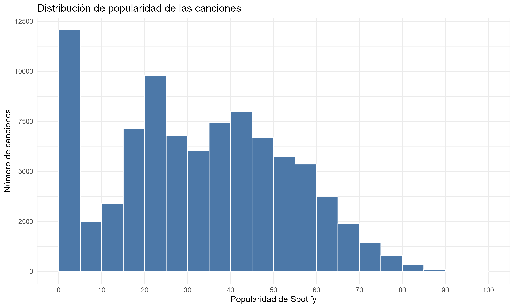
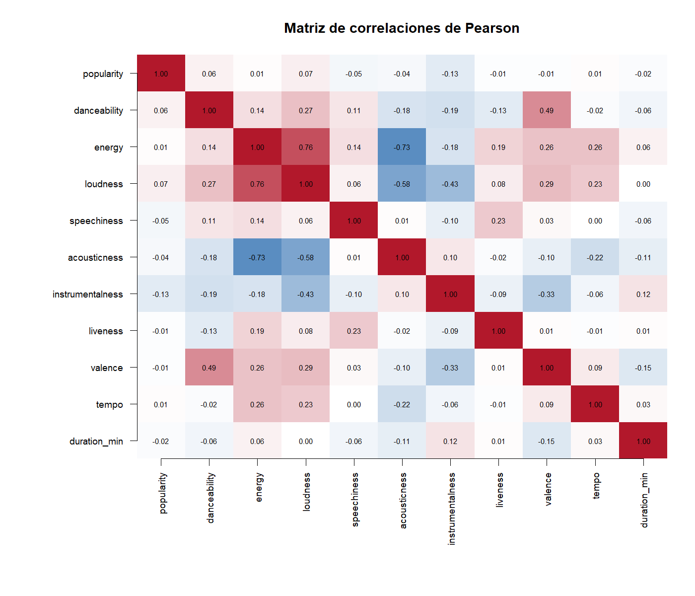
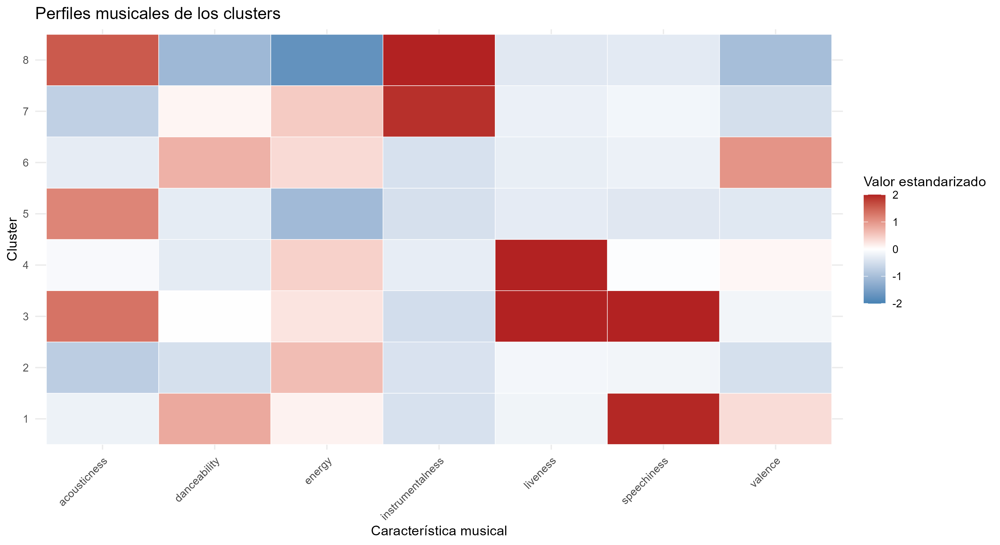
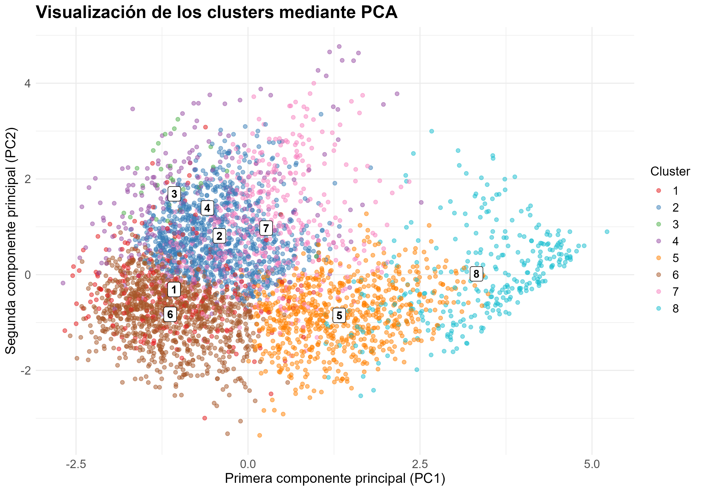

# Análisis de Spotify: popularidad y perfiles musicales

Proyecto de **Data Science en R** que estudia la relación entre las características musicales, los géneros y la popularidad de las canciones de Spotify. Combina análisis exploratorio, estadística descriptiva y clustering con **K-means** para identificar perfiles musicales y comparar su popularidad.

El análisis parte de **114.000 registros** y trabaja con **89.740 canciones únicas** después de la limpieza. El resultado principal es que las características musicales individuales presentan asociaciones lineales débiles con la popularidad. El clustering permite distinguir ocho perfiles acústicos, aunque sus distribuciones de popularidad se solapan.

**Autores:** Jacobo San Martín, Josemi Carrascosa y Jairo Alcívar.

## Preguntas del proyecto

- ¿Qué géneros presentan mayor y menor popularidad media?
- ¿Qué relación tienen la bailabilidad, la duración, la energía y la positividad musical con la popularidad?
- ¿Qué características diferencian a las canciones más populares de las menos populares?
- ¿Qué perfiles musicales se obtienen al agrupar canciones por sus características de audio?
- ¿Cómo se relacionan esos perfiles con la popularidad y los géneros tradicionales?

## Datos y preparación

Se utiliza el **Spotify Tracks Dataset**, publicado por Maharshi Pandya en [Kaggle](https://www.kaggle.com/datasets/maharshipandya/-spotify-tracks-dataset). El archivo original se encuentra en [data/raw/dataset.csv](data/raw/dataset.csv).

| Conjunto | Registros | Columnas |
|---|---:|---:|
| Original | 114.000 | 21 |
| Limpio | 89.740 | 20 |

La limpieza elimina valores ausentes, la columna de índice y los duplicados exactos. Después agrupa los registros por `track_id`, conserva las primeras características registradas de cada canción, combina sus géneros y utiliza la mediana cuando existen varios valores de popularidad.

El [dataset limpio](data/processed/spotify_clean.csv) no contiene valores ausentes ni identificadores duplicados. Se conservan las duraciones poco habituales y los valores de tempo iguales a cero: no se eliminan automáticamente como errores.

Las variables principales son `popularity`, `danceability`, `energy`, `valence`, `acousticness`, `instrumentalness`, `speechiness`, `liveness`, `loudness`, `tempo`, `duration_ms` y `track_genre`. Para los análisis de duración se convierten los milisegundos a minutos. La popularidad se analiza en su escala de 0 a 100.

## Estructura del repositorio

```text
spotify-music-analysis/
├── data/
│   ├── raw/dataset.csv
│   └── processed/spotify_clean.csv
├── scripts/
│   ├── data_exploration.R
│   ├── data_cleaning.R
│   ├── musical_features.R
│   ├── popularity_genres.R
│   ├── correlations.R
│   ├── danceability_duration_popularity.R
│   ├── popularity_comparison.R
│   └── clustering.R
├── results/
│   ├── descriptive/
│   ├── popularity/
│   ├── genres/
│   ├── correlations/
│   ├── danceability_duration_popularity/
│   ├── popularity_comparison/
│   └── clustering/
├── spotify-music-analysis.Rproj
└── README.md
```

Cada carpeta de `results` reúne las figuras y tablas de su análisis. La carpeta de clustering también incluye el modelo guardado en RDS y las canciones con su cluster asignado.

## Cómo ejecutar el proyecto

Se necesita **R**. RStudio es opcional, pero permite abrir directamente [spotify-music-analysis.Rproj](spotify-music-analysis.Rproj). Los paquetes utilizados son `tidyverse`, `cluster` y `scales`; los análisis descriptivos también emplean funciones de R base. `scales` se instala como dependencia de `ggplot2`, incluido en `tidyverse`.

1. Descarga o clona el repositorio:

   ```bash
   git clone https://github.com/josemicn11/spotify-music-analysis.git
   cd spotify-music-analysis
   ```

2. Abre el archivo `.Rproj` e instala las dependencias desde la consola de R:

   ```r
   install.packages(c("tidyverse", "cluster"))
   ```

3. Ejecuta los scripts desde la **raíz del proyecto**, donde se encuentra el archivo `.Rproj`:

   ```r
   source("scripts/data_exploration.R", encoding = "UTF-8")
   source("scripts/data_cleaning.R", encoding = "UTF-8")
   source("scripts/musical_features.R", encoding = "UTF-8")
   source("scripts/popularity_genres.R", encoding = "UTF-8")
   source("scripts/correlations.R", encoding = "UTF-8")
   source("scripts/danceability_duration_popularity.R", encoding = "UTF-8")
   source("scripts/popularity_comparison.R", encoding = "UTF-8")
   source("scripts/clustering.R", encoding = "UTF-8")
   ```

La exploración inicial inspecciona el archivo original; la limpieza genera el CSV que utilizan todos los análisis posteriores. Si ya dispones del CSV limpio, puedes ejecutar cada análisis de forma independiente. Los scripts crean sus carpetas de salida y sobrescriben los resultados del mismo nombre. Algunas expresiones exploratorias se muestran al ejecutarlas directamente en RStudio; para verlas al usar `source()`, añade `echo = TRUE`.

El clustering es el paso más costoso: prueba varios valores de K antes de ajustar el modelo final. Utiliza `set.seed(123)` para las muestras y los ajustes aleatorios. No se incluye un archivo de bloqueo de versiones de paquetes, por lo que pueden producirse diferencias entre entornos; `sessionInfo()` permite consultar las versiones utilizadas en cada ejecución.

## Metodología

| Script | Contenido |
|---|---|
| [data_exploration.R](scripts/data_exploration.R) | Dimensiones, ausentes, duplicados, consistencia y valores anómalos. |
| [data_cleaning.R](scripts/data_cleaning.R) | Limpieza y unificación de canciones por identificador. |
| [musical_features.R](scripts/musical_features.R) | Estadísticos descriptivos, histogramas, diagramas de caja y distribuciones. |
| [popularity_genres.R](scripts/popularity_genres.R) | Popularidad global, intervalos, clasificación de géneros y comparación de distribuciones. |
| [correlations.R](scripts/correlations.R) | Correlaciones de Pearson entre características y con la popularidad. |
| [danceability_duration_popularity.R](scripts/danceability_duration_popularity.R) | Relaciones con la bailabilidad y duración, ajustes lineales descriptivos e intervalos de duración. |
| [popularity_comparison.R](scripts/popularity_comparison.R) | Comparación de canciones con popularidad ≤ Q1 y ≥ Q3, incluyendo empates. |
| [clustering.R](scripts/clustering.R) | Estandarización, selección de K, K-means, perfiles acústicos, PCA y relación con géneros y popularidad. |

Para el análisis por géneros, cada canción se cuenta una vez en cada género al que pertenece. Por tanto, las categorías no son excluyentes. Los rankings se limitan a géneros con al menos 100 canciones.

## Resultados principales

### Popularidad global y géneros

| Indicador | Resultado |
|---|---:|
| Popularidad media | 33,20 |
| Mediana | 33 |
| Primer y tercer cuartil | 19 y 49 |
| Canciones con popularidad cero | 9.393 (10,47 %) |
| Canciones con popularidad ≤ 50 | 77,77 % |
| Canciones con popularidad > 75 | 1,43 % |



Los géneros con mayor popularidad media son **pop-film (59,28)**, **k-pop (56,96)** y **chill (53,70)**. En el extremo inferior aparecen **iranian (2,22)**, **romance (3,55)** y **latin (8,37)**. Estas cifras describen las canciones del dataset, no la popularidad de todo el catálogo de Spotify.

Las tablas completas están en [resumen global](results/popularity/01_resumen_popularidad_global.csv), [intervalos de popularidad](results/popularity/02_canciones_por_intervalo_popularidad.csv) y [popularidad por género](results/genres/03_popularidad_por_genero.csv).

### Características musicales y popularidad

Las asociaciones lineales con la popularidad son débiles: bailabilidad **r = 0,064**, duración **r = −0,023**, energía **r = 0,014** y positividad musical **r = −0,012**. La instrumentalidad presenta la asociación de mayor magnitud entre las variables analizadas, aunque sigue siendo débil: **r = −0,127**.

Entre las propias características musicales destacan energía–volumen (**r = 0,759**), energía–acústica (**r = −0,733**), volumen–acústica (**r = −0,583**) y bailabilidad–positividad (**r = 0,493**).



Al comparar duraciones, las canciones de **3 a menos de 4 minutos** tienen una popularidad media de **34,94**, frente a **27,97** para las de menos de 2 minutos y **30,06** para las de 5 minutos o más. La relación por intervalos aporta información que la correlación lineal global no resume por completo.

La comparación entre canciones con popularidad **≤ 19** y **≥ 49** muestra una instrumentalidad media de **0,254** y **0,127**, respectivamente. Los grupos incluyen empates en los cuartiles, por lo que pueden contener más del 25 % de las canciones.

Consulta las [correlaciones con popularidad](results/correlations/correlaciones_con_popularidad.csv), la [comparación por duración](results/danceability_duration_popularity/popularidad_por_intervalo_duracion.csv) y la [comparación entre grupos](results/popularity_comparison/comparacion_caracteristicas_musicales.csv).

### Ocho perfiles musicales con K-means

El clustering utiliza siete variables estandarizadas: `danceability`, `energy`, `valence`, `acousticness`, `instrumentalness`, `speechiness` y `liveness`. **La popularidad y el género no intervienen en el ajuste**; se utilizan después para interpretar los grupos.

Se exploran K = 1–12 mediante el método del codo y K = 2–12 mediante silueta sobre una muestra de 2.000 canciones. Se selecciona **K = 8** para obtener perfiles interpretables. La silueta próxima a 0,25 indica solapamiento: la elección no supone que existan ocho categorías naturales claramente separadas.

El modelo final utiliza 25 inicializaciones y un máximo de 100 iteraciones. El modelo guardado converge en **6 iteraciones**; la variabilidad entre clusters representa el **62,60 %** de la variabilidad total estandarizada.

| Cluster | Interpretación del perfil | Canciones | Popularidad media |
|---|---|---:|---:|
| 1 | Bailable, con mayor presencia de voz hablada | 5.788 | 34,79 |
| 2 | Intenso, energético y poco acústico | 19.812 | 36,25 |
| 3 | Principalmente hablado, con características de directo | 914 | 23,46 |
| 4 | Energético, con características de directo | 6.218 | 34,89 |
| 5 | Acústico y de menor intensidad | 16.585 | 32,68 |
| 6 | Bailable, energético y positivo | 24.114 | 33,95 |
| 7 | Instrumental y energético | 9.740 | 27,11 |
| 8 | Instrumental, acústico y tranquilo | 6.569 | 29,90 |

Los nombres son interpretaciones descriptivas de los perfiles, no etiquetas proporcionadas por el dataset. Los identificadores corresponden al modelo guardado.



El PCA se utiliza para visualizar los grupos, no para entrenar K-means. Sus dos primeras componentes recogen el **50,28 %** de la variabilidad: **30,68 %** en PC1 y **19,60 %** en PC2. El gráfico representa una muestra de 4.000 canciones y muestra el solapamiento entre perfiles.



La mayor popularidad media corresponde al cluster 2 y la menor al cluster 3. Las distribuciones se solapan, por lo que pertenecer a un cluster no permite determinar la popularidad de una canción. Los perfiles también reúnen distintos géneros musicales y no equivalen directamente a esas categorías.

Puedes consultar la [popularidad por cluster](results/clustering/popularidad_clusters_k8.csv), las [asignaciones de canciones](results/clustering/spotify_clusters_k8.csv) y el [modelo K-means](results/clustering/modelo_kmeans_k8.rds).

## Conclusiones y límites

El proyecto identifica relaciones entre características de audio y ocho perfiles musicales interpretables. Sin embargo, las características individuales y los perfiles obtenidos no explican por sí solos la popularidad de las canciones.

- Las correlaciones describen asociaciones, no causalidad. Un valor de Pearson próximo a cero no descarta relaciones no lineales.
- El estudio describe este dataset; no analiza la evolución temporal ni incorpora factores como promoción, exposición o audiencia de los artistas.
- K-means depende de las variables, la estandarización y el número de grupos. La silueta relativamente baja aconseja interpretar los clusters como perfiles descriptivos.
- La proyección PCA muestra aproximadamente la mitad de la variabilidad y no representa todas las distancias del espacio original.
- No se entrena ni se evalúa un modelo predictivo de popularidad. Los ajustes lineales de los gráficos son descriptivos.

Como continuación del trabajo, se podrían estudiar relaciones no lineales, incorporar variables externas y comparar otros métodos de agrupación.
